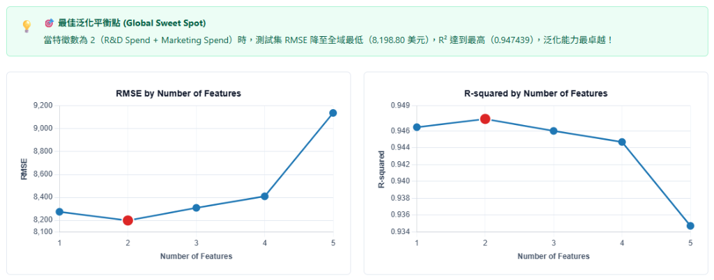

# AIoT-DA 多元線性回歸專題 (50_Startups Profit Prediction)

本專案遵循 **CRISP-DM（跨領域資料採掘標準流程）** 架構，針對 Kaggle 經典新創公司資料集（50_Startups）進行多元線性回歸（Multiple Linear Regression）建模，並透過前向逐步特徵選取（Forward Feature Selection）探索最佳獲利預測變數組合。

---

## 🌐 互動式 Web 儀表板 (Live Dashboard)

專案提供已部署至 GitHub Pages 的動態互動儀表板：

👉 **[點此造訪 Live Demo: https://contemplator.github.io/nchu-startup-50/](https://contemplator.github.io/nchu-startup-50/)**

* 🎚️ **前向特徵選取探索器**：動態滑動特徵數量（1~5），即時聯動 RMSE 與 R-squared 雙折線圖與表格。
* 💡 **過擬合智能警示**：動態判別最佳泛化點（2 特徵）與雜訊過擬合區間（3~5 特徵）。
* 🧮 **What-If 利潤試算機**：拖曳研發與行銷預算滑桿，即時以最佳回歸方程式推算預期年利潤。
* 📈 **模型診斷與殘差分析**：測試集 10 筆樣本之實際值 vs 預測值對角線圖與殘差分佈。

---

## 📁 專案檔案清單

* **[Startup_50_MLR_CRISP_DM.ipynb](./Startup_50_MLR_CRISP_DM.ipynb)**：50_Startups 利潤預測 Jupyter Notebook，完整涵蓋 CRISP-DM 六步驟、前向特徵選取演算法與模型診斷。
* **[Boston_Housing_MLR_CRISP_DM.ipynb](./Boston_Housing_MLR_CRISP_DM.ipynb)**：Boston Housing 房價預測 Jupyter Notebook，實作五大特徵選取方法（Forward, Backward, Lasso, RFE, SelectKBest）與 1~13 特徵雙折線圖評估。
* **[dashboard_preview.png](./dashboard_preview.png)**：互動式 Web 儀表板執行與過擬合警示預覽截圖。
* **[web/](./web/)**：Clean Light Academic 風格的靜態互動網頁（`index.html`, `style.css`, `app.js`, `data.json`）。
* **[export_web_data.py](./export_web_data.py)**：機器學習資料處理與前端 JSON 匯出腳本。
* **[.github/workflows/deploy.yml](./.github/workflows/deploy.yml)**：GitHub Actions CI/CD 自動化建置與 Pages 部署流程。
* **[assignment_result_plot.png](./assignment_result_plot.png)**：特徵數量對應 RMSE 與 R-squared 之高解析度折線圖。

---

## 🚀 如何執行

### 方式 A：本地 VS Code / Jupyter Notebook
1. 直接在 VS Code 側邊欄點擊打開 [Startup_50_MLR_CRISP_DM.ipynb](./Startup_50_MLR_CRISP_DM.ipynb)。
2. 本筆記本的所有程式格已事先執行完畢，所有折線圖、熱力圖、殘差圖與表格輸出均已內嵌可見。
3. 若需重新執行，點擊筆記本頂部「**全部執行 (Run All)**」即可。

### 方式 B：Google Colab
1. 將 `Startup_50_MLR_CRISP_DM.ipynb` 上傳至 Google Drive 或 GitHub。
2. 透過 Google Colab 打開該檔案。
3. 點擊「**代碼執行階段 -> 全部執行**」，環境會自動下載依賴套件並直接串流資料集完成分析。
